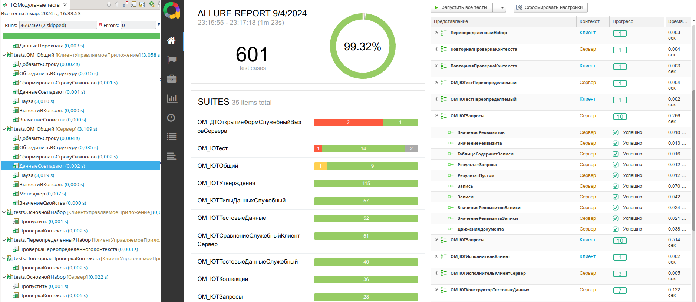
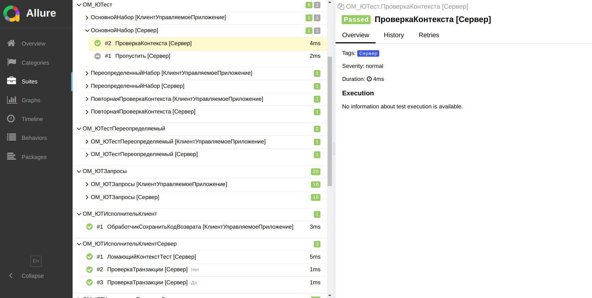
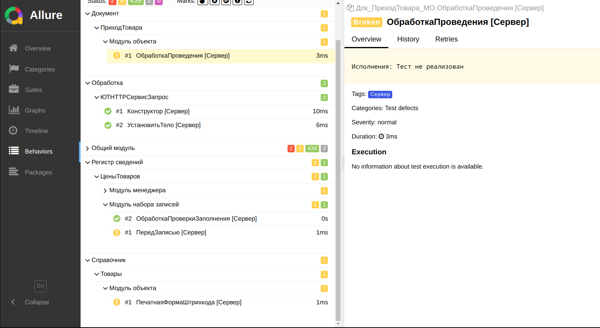

# Отчеты о тестировании

Важным этапом тестирования является формирование удобного и информативного отчета. YAxUnit предоставляет возможность работать с различными видами отчетов.

* Отчет в формате JUnit - используется при разработке тестов в EDT, позволяет быстро увидеть результат тестирования прямо в IDE, позволяет переходить по стеку ошибок и сравнивать фактическое и ожидаемое значение.
* Отчет в формате Allure - чаще всего применяется в CI, имеет богатую функциональность: фильтрация, различные группировки, история и статистика.
* Отчет в формате CTRF - универсальный машинный JSON-формат для CI/CD, принимается множеством сторонних инструментов (валидаторы, GitHub Actions, боты для Slack/Teams).
* Отчет в режиме 1С:Предприятия - удобен если вы не используете (или не можете использовать) по какой-либо причине EDT.



Указать необходимый формат вы может в [параметрах запуска](../../getting-started/run/configuration), либо в [форме настроек](../../yaxunit-ui#интерфейс-настройки-конфигурации).
По умолчанию используется формат `JUnit`. Также поддерживается одновременное формирование нескольких отчетов через параметр `reports` (см. конфигурацию запуска).

## Формат `JUnit`

Широко распространенный формат отчетов о тестировании. Используется для интеграции с [плагином запуска тестов из EDT](https://github.com/bia-technologies/edt-test-runner). В отличие от Allure позволяет хранить и сравнивать ожидаемое и фактическое значения. Подходит для процесса разработки/отладки тестов.

## Формат `Allure`

Чаще применяется в CI как более универсальный и удобный способ организации отчетов о тестировании. Позволяет добавлять различную мета информацию, которая будет отображаться в отчете, имеет различные способы группировки, историю запусков и многое другое.

### Поддержка smoke тестов

YAxUnit обеспечивает корректное отображение smoke тестов в Allure отчетах. Каждый smoke тест отображается как отдельный тест с уникальным названием, что позволяет:

- Видеть все индивидуальные smoke тесты в отчете
- Фильтровать и группировать тесты по различным критериям
- Анализировать результаты каждого теста отдельно
- Сохранять группировку по типам приложений и коллекциям метаданных

Например, для модуля `ДТОткрытиеФорм` с 1754 smoke тестами, в Allure отчете будет отображаться каждый тест отдельно, а не как один групповой тест.

### Группировка по тестовым наборам



### Группировка по функциональности



## Формат `CTRF`

[CTRF](https://ctrf.io) (Common Test Report Format) — открытый стандарт JSON-отчетов о тестировании, единый для различных фреймворков. Подходит для CI/CD: файл `ctrf-report.json` принимается сторонними инструментами CTRF (валидатором `ctrf-cli`, GitHub Actions, ботами для Slack/Teams и другими) без промежуточного преобразования.

Формат подключается параметром `reportFormat: "ctrf"` или элементом массива `reports`:

```json
{
    "reportFormat": "ctrf",
    "reportPath": "ctrf-report.json"
}
```

или

```json
{
    "reports": [
        { "format": "ctrf", "path": "ctrf-report.json" }
    ]
}
```

### Структура отчета

Отчет соответствует спецификации CTRF 0.2.0 (strict core) и состоит из:

* `reportFormat` - всегда `"CTRF"`;
* `specVersion` - версия спецификации, всегда `"0.2.0"`;
* `results.tool` - инструмент тестирования: `name` = `"YAxUnit"`, `version` = версия YAxUnit;
* `results.summary` - сводка прогона: счетчики `tests`/`passed`/`failed`/`pending`/`skipped`/`other` и времена `start`/`stop` (Unix-миллисекунды);
* `results.tests` - плоский массив тестов. Каждый тест содержит `name`, `status`, `duration` (миллисекунды) и `suite` - иерархию `[имя модуля, имя набора]`; опционально `start`, `message`/`trace` (первая ошибка), `tags`, `rawStatus`;
* `results.environment` - опциональный раздел окружения: `appName` (конфигурация), `appVersion` (версия конфигурации), `osPlatform` (ОС сервера); заполняется только непустыми полями.

Пример (сокращен; получен из реального прогона):

```json
{
    "reportFormat": "CTRF",
    "specVersion": "0.2.0",
    "results": {
        "tool": {
            "name": "YAxUnit",
            "version": "25.12"
        },
        "summary": {
            "tests": 2,
            "passed": 1,
            "failed": 0,
            "pending": 0,
            "skipped": 1,
            "other": 0,
            "start": 1793664788119,
            "stop": 1793664788120
        },
        "tests": [
            {
                "name": "ЗначениеСтруктуры",
                "status": "passed",
                "duration": 1,
                "suite": ["ОМ_ЮТКоллекции", "ОМ_ЮТКоллекции"],
                "start": 1793664788119
            },
            {
                "name": "ДанныеЗависимости_НеизвестныйФайл",
                "status": "skipped",
                "duration": 0,
                "suite": ["ОМ_ЮТЗависимостиСлужебный", "ОМ_ЮТЗависимостиСлужебный"]
            }
        ],
        "environment": {
            "osPlatform": "Linux",
            "appVersion": "1.0.26.1",
            "appName": "Демонстрационное приложение"
        }
    }
}
```

### Соответствие статусов

Статусы исполнения тестов YAxUnit преобразуются в статусы CTRF:

| Статус YAxUnit    | Статус CTRF | `rawStatus`       |
|-------------------|-------------|-------------------|
| `Успешно`         | `passed`    | -                 |
| `Ошибка`          | `failed`    | -                 |
| `Сломан`          | `failed`    | `Сломан`          |
| `Пропущен`        | `skipped`   | -                 |
| `НеРеализован`    | `skipped`   | `НеРеализован`    |
| `Ожидание`        | `skipped`   | `Ожидание`        |
| `Исполнение`      | `other`     | `Исполнение`      |

Для статусов с не однозначным соответствием (`Сломан`, `НеРеализован`, `Ожидание`, `Исполнение`) в запись теста добавляется `rawStatus` - исходный статус YAxUnit. У упавших тестов `message` и `trace` заполняются из первой ошибки.

### Ошибки модулей и наборов

Если модуль или набор завершился с ошибками (например, при загрузке тестов), в `results.tests` добавляется синтетическая запись со статусом `failed`, чтобы ошибки прогона не терялись в отчете:

* для набора: `name` = `"<Представление> [<Режим>]"`, `suite` = `[имя модуля]`;
* для модуля: `name` = имя модуля, свойство `suite` опускается (пустой массив запрещен схемой).

### Ограничения

* Формирование отчета в формате CTRF не поддерживается в web-клиенте - генератор выбрасывает исключение `Формирование отчета в формате CTRF не поддерживается в web-клиенте`. Это исключение обрывает цепочку формирования отчетов до вызова финального обработчика: остальные отчеты из `reports` успевают сформироваться, но прогон завершается по таймауту без кода возврата. Поэтому не используйте формат `ctrf` при запуске тестов в web-клиенте.
* Отчет соответствует спецификации CTRF 0.2.0; обновление до новых версий спецификации - по мере необходимости.
