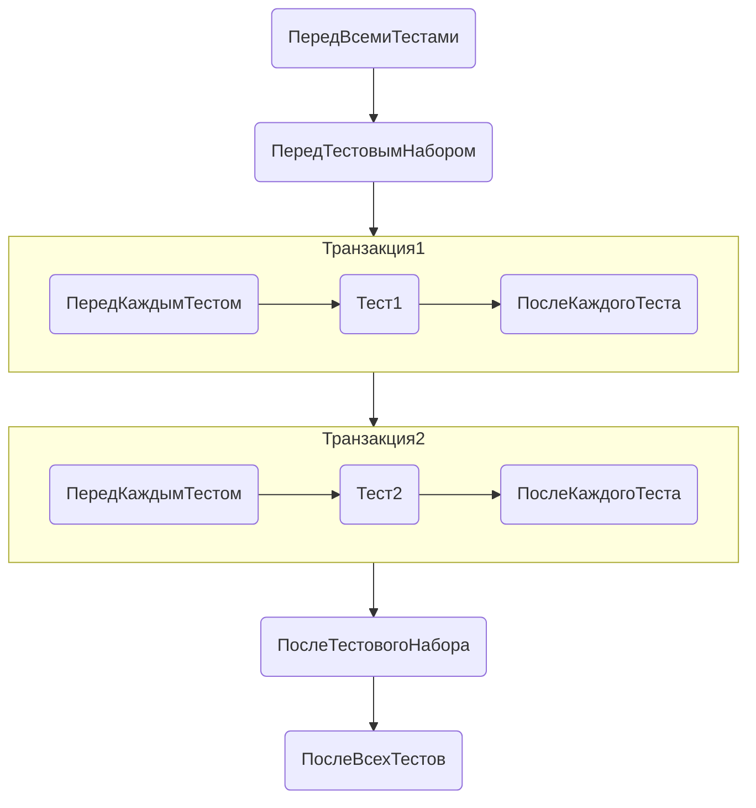
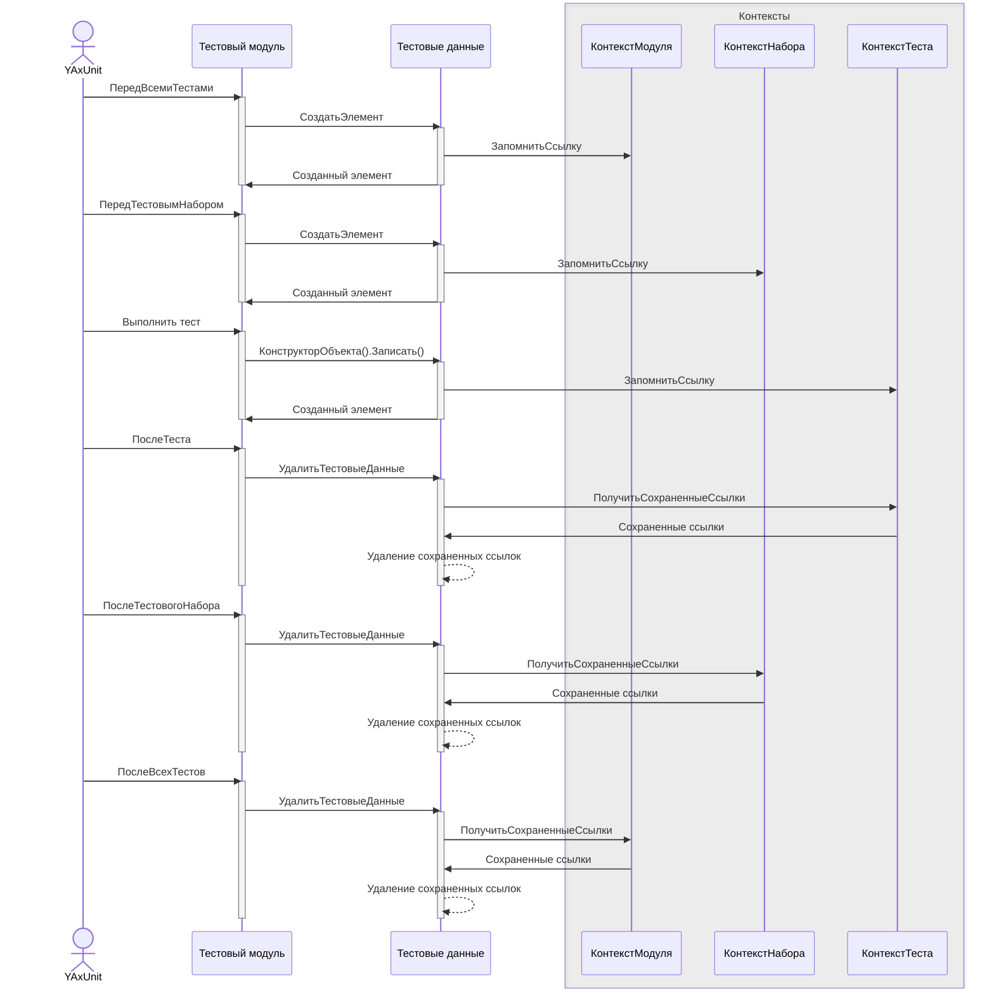

# Удаление тестовых данных

При использовании тестовых данных нередко необходимо удалять созданные объекты.

Для этого вы можете использовать

## Автоматические транзакции

Самый простой в способ отката изменений сделанных тестом - обернуть тест в транзакцию.  
Для того чтобы YAxUnit сам оборачивал тесты в транзакции вам, при регистрации теста, нужно вызвать метод [`ВТранзакции()`](/api/ЮТТесты#втранзакции).

* Если метод вызвать в самом начале, то настройка примениться для всех тестов модуля;
* если после добавления набора, то для всех тестов этого набора;
* если после добавления теста, то только для этого теста.
* Также можно отключать использование транзакции, указав параметр `ВТранзакции(Ложь)`

```bsl title=ВТранзакции.bsl
ЮТТесты
    .ДобавитьТест("Фикция").ВТранзакции() // Использование транзакции для конкретного теста
;

ЮТТесты
    .ДобавитьТестовыйНабор("Основной").ВТранзакции() // Использование транзакции для набора тестов
    .ДобавитьТест("Фикция")
;

ЮТТесты.ВТранзакции() // Использование транзакции для тестов модуля
    .ДобавитьТест("Фикция")
;
```

И тогда тестовый движок будет оборачивать в транзакцию **каждый серверный тест** (для клиентских будет игнорироваться)

Особенности работы:

* В транзакцию оборачивается только тест и [события](../events.md) `ПередКаждымТестом\ПередТестом` и `ПослеКаждогоТеста\ПослеТеста`
* Для клиентских тестов настройка игнорируется

### Схема работы транзакций

Для настройки

```bsl title='Тесты набора с настройкой ВТранзакции'
ЮТТесты
    .ДобавитьТестовыйНабор("Основной").ВТранзакции()
        .ДобавитьТест("Тест1")
        .ДобавитьТест("Тест2")
```

Схема выполнения будет выглядеть так:



Точно также она будет выглядеть и для настройки

```bsl
ЮТТесты.ВТранзакции()
    .ДобавитьТестовыйНабор("Основной")
        .ДобавитьТест("Тест1")
        .ДобавитьТест("Тест2")
```

:::caution Учитывайте
В транзакцию оборачивается тест, а не модуль или набор, поэтому данные созданные вне теста не будут удалены.
Такие данные необходимо удалять самостоятельно при необходимости.

Например, настройка

```bsl
ЮТТесты
    .ДобавитьТестовыйНабор("Основной").ВТранзакции() // Использование транзакции для набора тестов
```

указывает, что каждый тест набор будет выполняться в своей транзакции, которая будет отменена по окончании каждого теста.
:::

## Механизм удаления тестовых данных

В некоторых ситуация тестирование в транзакции невозможно:

* Клиентский тест
* Тестируемый метод не рассчитан на работу в транзакции (например, используются внутренние транзакции)
* Необходимо создавать данные за рамками теста (общие параметры)

В подобных случаях, для удаления созданных данных, может подойти механизм удаления тестовых данных.

Для его включения нужно при регистрации теста вызвать метод [`УдалениеТестовыхДанных()`](/api/ЮТТесты#удалениетестовыхданных).

:::caution Механизм имеет ряд ограничений и не работает для следующих кейсов:

* Данные созданы не через API
* Данные создаются внутри тестируемого кода
* Данные созданы в клиентском модуле через вызов своего серверного модуля, даже если он использует API тестового движка
:::

```bsl title=УдалениеТестовыхДанных.bsl
ЮТТесты
    .ДобавитьТест("Фикция").УдалениеТестовыхДанных() // Использование для конкретного теста

ЮТТесты
    .ДобавитьТестовыйНабор("Основной").УдалениеТестовыхДанных() // Использование для всех тестов набора
    .ДобавитьТест("Фикция")

ЮТТесты.УдалениеТестовыхДанных() // Использование для всех тестов модуля
    .ДобавитьТест("Фикция")

ЮТТесты.ВТранзакции().УдалениеТестовыхДанных() // Совместно с транзакцией
    .ДобавитьТест("Фикция")

```

Механизм не использует транзакции, а запоминает в контексте все созданные с помощью API объекты и записи регистров сведений.
Позволяет:

* Удалять данные созданные с клиента
* Удалять данные созданные вне теста (в обработчиках событий)

:::caution Удаление и только
Механизм только удаляет созданные объекты, изменения не откатываются
:::

:::tip Разное время жизни данных
Механизм понимает в рамках какого контекста исполнения (тест, набор, модуль) были созданы данные и удаляет их по выходу из него.
:::

Рассмотрим время жизни объектов созданных на разных этапах тестирования, например имеем такой модуль.

```bsl title=УдалениеТестовыхДанныхВремяЖизни.bsl
Процедура ПередВсемиТестами() Экспорт
    ДанныеМодуля = ЮТест.Данные().СоздатьЭлемент();
КонецПроцедуры

Процедура ПередТестовымНабором() Экспорт
    ДанныеНабора = ЮТест.Данные().СоздатьЭлемент();
КонецПроцедуры

Процедура ПослеВсехТестов() Экспорт
    ДанныеТеста = ЮТест.Данные().СоздатьЭлемент();
КонецПроцедуры

Процедура Тест() Экспорт
    Ссылка = ЮТест.Данные().СоздатьЭлемент();
КонецПроцедуры
```

Для переменных получим разное время жизни

* `ДанныеМодуля` - Живет, пока исполняются тесты модуля одного контекста (Сервер, Клиент).
* `ДанныеНабора` - Живет, пока исполняются тесты набора.
* `ДанныеТеста` и `Ссылка` -  Живут, пока исполняется тест.

### Схема работы механизма "УдалениеТестовыхДанных"



## Кастомизация удаления

В некоторых конфигурациях штатное удаление объектов не подходит:

* строгий контроль удаления (подписки на события объектов, запреты `ОбменДанными.Загрузка`);
* собственные регламенты удаления (архивирование, контроль ссылок, логирование).

Для таких случаев механизм предоставляет два инструмента. Их можно использовать как по отдельности, так и вместе.

* Событие `ПередУдалениемТестовыхДанных` - глобальная замена/корректировка стратегии удаления.
* Метод `ЮТест.Данные().ЗарегистрированныеКУдалению()` - точечное изъятие данных для самостоятельного удаления.

### Событие ПередУдалениемТестовыхДанных

Событие вызывается перед штатной очисткой буфера каждого уровня исполнения (теста, набора, модуля), если этот буфер не пуст.

Обработчик - серверный [модуль-подписчик на события движка](../events.md#подписка-на-события-движка), размещенный в подсистеме группы `ИсполнениеТестов`.

```bsl title="УдалениеТестовыхДанныхНаСвоейЛогике"
// Общий модуль `УдалениеТестовыхДанныхНаСвоейЛогике` (серверный),
// размещен в подсистеме `<МоиПодключаемыеМодули>/ОбработчикиСобытий/ИсполнениеТестов`

Процедура ПередУдалениемТестовыхДанных(Объекты, СтандартнаяОбработка) Экспорт

    // Удаление своими средствами (например, с обходом строгого контроля)
    УдалитьОбъектыСЗагрузкойОбмена(Объекты);

    // Отключить штатное удаление - фреймворк не будет удалять полученные объекты
    СтандартнаяОбработка = Ложь;

КонецПроцедуры
```

Параметры:

* `Объекты` - Массив - тестовые данные уровня (ссылки и ключи записей регистров), подготовленные к удалению. Массив можно изменять:
  * исключение элементов - оставшиеся будут удалены штатно (удалённые вами фреймворк не тронет);
  * добавление элементов - они будут удалены штатно.
* `СтандартнаяОбработка` - Булево - признак выполнения штатного удаления. По умолчанию `Истина`.

Правила работы с событием:

* Отмена штатного удаления - только сбросом `СтандартнаяОбработка = Ложь`. Установка `Истина` после другого обработчика не поддерживается (значение не "приклеивается" обратно).
* Отмена действует на всю очистку текущего уровня (включая записи регистров) и окончательна - повторной попытки удаления не будет.
* При полной отмене записи регистров не удаляются вообще - удалите их в обработчике самостоятельно, если они мешают.
* Событие касается только авто-очистки. Ручные вызовы `ЮТест.Данные().Удалить()` событием не сопровождаются.
* Событие не вызывается на пустом буфере уровня и при выключенной настройке [`УдалениеТестовыхДанных(Ложь)`](#механизм-удаления-тестовых-данных) для этого уровня.
* Ошибка обработчика не прерывает прогон: логируется как предупреждение, штатная очистка выполняется.
* Событие срабатывает в том контексте, где жил буфер (для клиентских тестов - в контексте клиента, серверные вызовы теста наполняют серверный буфер).

### Метод ЗарегистрированныеКУдалению

Метод [`ЮТест.Данные().ЗарегистрированныеКУдалению()`](/api/ЮТТестовыеДанные#зарегистрированныекудалению) возвращает ссылки на объекты, накопленные буфером **текущего уровня исполнения**, и исключает их из буфера - фреймворк не будет удалять их штатно.

```bsl title="Самостоятельное удаление в теле теста"
Процедура ТестСозданиеСтрогоКонтролируемогоОбъекта() Экспорт

    // Создание данных через API тестовых данных - они регистрируются в буфере удаления
    Объект = ЮТест.Данные().КонструкторОбъекта("Справочники.СтрогоКонтролируемыеОбъекты")
        .Установить("Наименование", "Тестовый объект")
        .Записать();

    // ... проверки

    // Изымаем свои объекты из авто-удаления и удаляем по правилам конфигурации
    Ссылки = ЮТест.Данные().ЗарегистрированныеКУдалению();
    УдалитьСтрогоКонтролируемыеОбъекты(Ссылки);

КонецПроцедуры
```

Особенности:

* Возвращает только ссылки на объекты; ключи записей регистров остаются фреймворку (удаляются штатно).
* Возвращает данные текущего уровня исполнения: вызванный в теле теста метод не увидит данные набора/модуля; вызванный в событии `ПередТестом` - данные, созданные к этому моменту в этом же контексте.
* Повторный вызов возвращает пустой массив - ссылки уже исключены из буфера.
* При выполнении теста в транзакции ([`ВТранзакции()`](#автоматические-транзакции)) или при `УдалениеТестовыхДанных(Ложь)` данные не накапливаются - метод вернет пустой массив.

### Комбинирование инструментов

Инструменты можно совмещать: метод изымает ссылки уровня, событие получает оставшееся (в т.ч. ключи записей регистров).

```bsl title="Геттер + событие"
// Тело теста (уровень теста)
Процедура ТестОбмена() Экспорт

    Валюта = ЮТест.Данные().СоздатьЭлемент("Справочники.Валюты");
    ЮТест.Данные().КонструкторОбъекта("РегистрыСведений.КурсыВалют")
        .Установить("Валюта", Валюта)
        .Установить("Курс", 70)
        .Записать();

    // Изымаем ссылку и удаляем сами - по правилам нашей конфигурации
    Ссылки = ЮТест.Данные().ЗарегистрированныеКУдалению();
    УдалитьСтрогоКонтролируемыеОбъекты(Ссылки);
    // Ключ записи регистра остался фреймворку - штатная очистка удалит запись,
    // событие `ПередУдалениемТестовыхДанных` получит ее в коллекции `Объекты`

КонецПроцедуры
```

:::caution Ведущие измерения регистров
Если изъятая ссылка является ведущим измерением (`master`) записи регистра, платформа удалит запись каскадно при удалении ссылки. Учитывайте это при самостоятельном удалении: событие и штатная очистка удаляют только то, что осталось в буфере.
:::

### Что выбрать

| Ситуация | Инструмент |
| --- | --- |
| Нужно удалить несколько конкретных объектов в своем коде (в теле теста или событии уровня) | `ЗарегистрированныеКУдалению()` |
| Конфигурация запрещает/ломает стандартное `Объект.Удалить()` для всех тестовых объектов | Подписчик `ПередУдалениемТестовыхДанных` + `СтандартнаяОбработка = Ложь` |
| Часть объектов удалить самому, остальное оставить фреймворку | Подписчик: исключить удалённое из `Объекты`, `СтандартнаяОбработка` не трогать |
| Данные набора/модуля нужно удалять по своей логике | Подписчик (геттер из тела теста данные набора не видит) |

## Глобальная настройка удаления данных

Для глобальной настройки [`ВТранзакции()`](/api/ЮТТесты#втранзакции) и/или [`УдалениеТестовыхДанных()`](/api/ЮТТесты#удалениетестовыхданных) вам необходимо всего лишь создать свой общий модуль, подписать на событие инициализации и там установить глобальные настройки.

Подробнее тема будет раскрыта в будущем.
